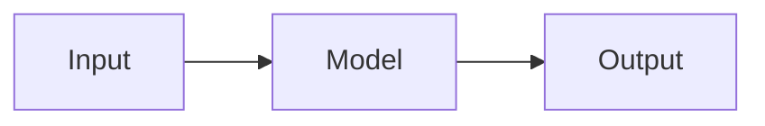

# Write MDX Content

Guide for writing and editing article content in MDX.

## Content structure

```
app/src/content/
├── article.mdx              # Main entry point (frontmatter + chapter imports)
├── bibliography.bib          # BibTeX references
├── chapters/                 # One .mdx file per section
│   ├── introduction.mdx
│   └── methods.mdx
├── embeds/                   # D3/HTML visualizations
└── assets/
    ├── data/                 # CSV/JSON data files
    └── image/                # Images (optimized at build)
```

## Creating a chapter

### 1. Create the MDX file

Create `app/src/content/chapters/my-chapter.mdx`:

```mdx
import Sidenote from '../../components/Sidenote.astro';
import Note from '../../components/Note.astro';
import Image from '../../components/Image.astro';
import myImage from '../assets/image/my-image.png';

## My Chapter Title

Content goes here with **markdown** and components.
```

### 2. Import it in article.mdx

```mdx
import MyChapter from "./chapters/my-chapter.mdx";

<MyChapter />
```

Chapter order in `article.mdx` determines render order.

### Import path patterns

From a file in `chapters/`:

| Target | Import path |
|--------|-------------|
| Components | `../../components/ComponentName.astro` |
| Images | `../assets/image/filename.png` |
| Data | Referenced via `HtmlEmbed data` prop, not imported directly |

From a file in `chapters/subfolder/`:

| Target | Import path |
|--------|-------------|
| Components | `../../../components/ComponentName.astro` |
| Images | `../../assets/image/filename.png` |

## Available components

### Image

Optimized image with optional caption, zoom, download, and link.

```mdx
import Image from '../../components/Image.astro';
import myImg from '../assets/image/photo.png';

<Image src={myImg} alt="Description" />
<Image src={myImg} alt="With caption" caption="Figure caption text" zoomable />
<Image src={myImg} alt="Linked" linkHref="https://example.com" />
```

| Prop | Type | Default | Description |
|------|------|---------|-------------|
| `src` | ImageMetadata | required | Imported image |
| `alt` | string | required | Accessibility text |
| `caption` | string | — | HTML caption below image |
| `zoomable` | boolean | true | Enable click-to-zoom |
| `downloadable` | boolean | — | Show download button |
| `linkHref` | string | — | Wrap image in a link |
| `fullWidth` | boolean | false | Span full content width |
| `skipGallery` | boolean | false | Exclude from /dataviz page |

### Sidenote

Margin note displayed alongside content.

```mdx
import Sidenote from '../../components/Sidenote.astro';

<Sidenote>This appears in the margin on desktop.</Sidenote>
```

No props. Content via default slot.

### Note

Callout box with optional title, emoji, and variant.

```mdx
import Note from '../../components/Note.astro';

<Note>Default neutral note.</Note>
<Note variant="info" emoji="💡" title="Tip">Informational note.</Note>
<Note variant="danger">Warning note.</Note>
```

| Prop | Type | Default | Description |
|------|------|---------|-------------|
| `variant` | `"neutral"` / `"info"` / `"success"` / `"danger"` | `"neutral"` | Color variant |
| `title` | string | — | Optional heading |
| `emoji` | string | — | Emoji before title |

### Quote

Styled blockquote with attribution.

```mdx
import Quote from '../../components/Quote.astro';

<Quote author="Einstein" source="Letter to Born, 1926">
  God does not play dice with the universe.
</Quote>
```

| Prop | Type | Description |
|------|------|-------------|
| `author` | string | Attribution name |
| `source` | string | Source text (HTML allowed) |

### Stack

Grid layout for side-by-side content.

```mdx
import Stack from '../../components/Stack.astro';

<Stack layout="2-column" gap="medium">
  <div>Column 1</div>
  <div>Column 2</div>
</Stack>
```

| Prop | Type | Default | Description |
|------|------|---------|-------------|
| `layout` | `"2-column"` / `"3-column"` / `"4-column"` / `"auto"` | `"2-column"` | Grid columns |
| `gap` | `"small"` / `"medium"` / `"large"` / custom string | `"medium"` | Gap between items |

### Accordion

Collapsible details section.

```mdx
import Accordion from '../../components/Accordion.astro';

<Accordion title="Show code">
  Content revealed on click.
</Accordion>
```

| Prop | Type | Default | Description |
|------|------|---------|-------------|
| `title` | string | required | Summary text |
| `open` | boolean | false | Start expanded |

### HtmlEmbed

Inject a self-contained HTML visualization (D3 chart, diagram).

```mdx
import HtmlEmbed from '../../components/HtmlEmbed.astro';

<HtmlEmbed src="d3-my-chart.html" title="Chart Title" />
<HtmlEmbed src="d3-bar.html" title="Memory usage by sequence length" />
<HtmlEmbed src="d3-my-chart.html" title="Loss" data="training_loss.csv" config={{ yLabel: 'Loss' }} />
```

To build a new embed, use the `create-html-embed` skill.

| Prop | Type | Default | Description |
|------|------|---------|-------------|
| `src` | string | required | Path to HTML file in `embeds/` |
| `title` | string | — | Title above the card |
| `desc` | string | — | Description below (HTML ok) |
| `frameless` | boolean | false | Remove card border/background |
| `wide` | boolean | false | Wide layout (~1100px) |
| `data` | string / string[] | — | Data file path(s) |
| `config` | object | — | JSON config passed to embed |
| `skipGallery` | boolean | false | Exclude from /dataviz page |

### Wide / FullWidth

Layout wrappers to break out of the main column.

```mdx
import Wide from '../../components/Wide.astro';
import FullWidth from '../../components/FullWidth.astro';

<Wide>Content wider than main column.</Wide>
<FullWidth>Edge-to-edge content.</FullWidth>
```

No required props. Optional `class`.

### Glossary

Inline term with tooltip definition.

```mdx
import Glossary from '../../components/Glossary.astro';

The <Glossary term="KV cache" definition="Key-Value cache stores attention keys and values to avoid recomputation during autoregressive generation.">KV cache</Glossary> is critical for inference speed.
```

## Markdown syntax

All standard markdown works natively. Key extensions:

### Math (KaTeX)

```markdown
Inline: $E = mc^2$

Block:
$$
\mathcal{L} = -\sum_{i} y_i \log(\hat{y}_i)
$$
```

### Citations

Requires entries in `bibliography.bib`:

```bibtex
@article{vaswani2017attention,
  title={Attention is all you need},
  author={Vaswani, Ashish and others},
  journal={NeurIPS},
  year={2017}
}
```

Then in MDX:

```markdown
Transformers [@vaswani2017attention] revolutionized NLP.
Multiple: [@vaswani2017attention; @devlin2019bert]
```

A citation section is auto-generated at the end.

### Footnotes

```markdown
This claim needs context[^1].

[^1]: Additional context explaining the claim.
```

### Code blocks

````markdown
```python
def hello():
    return "world"
```
````

With output display:

````markdown
```python
print("hello")
```

:::output
hello
:::
````

### Mermaid diagrams

````markdown

````

### Tables

```markdown
| Model | Params | Score |
|-------|--------|-------|
| GPT-4 | 1.8T | 86.4 |
| LLaMA | 65B | 63.4 |
```

### Horizontal rules

```markdown
---
```

## Best practices

1. **One chapter per concept** - Keep chapters focused and importable independently
2. **Images via import** - Always import images (enables optimization): `import img from '../assets/image/photo.png'`
3. **Sidenotes for context** - Use Sidenote for supplementary info that would interrupt flow
4. **Note for warnings/tips** - Use Note with appropriate variant for callouts
5. **Citations in bib** - Add BibTeX entries to `bibliography.bib`, reference with `[@key]`
6. **HtmlEmbed for dataviz** - Use the `create-html-embed` skill to build charts and the `design-dataviz` skill to design them
7. **skipGallery on decorative items** - Add `skipGallery` to banners/decorative embeds not meant for the /dataviz page
